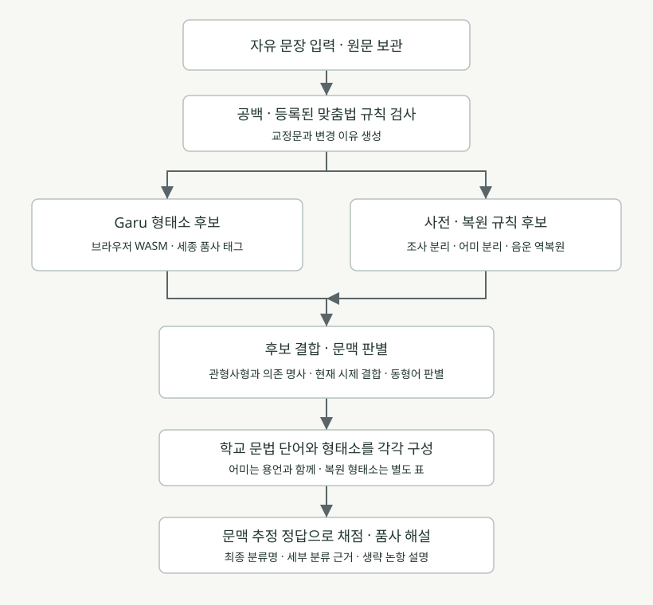

# PoomSa 하이브리드 형태소 분석기

원본은 `Goldhobbang/PoomSa`의 main 커밋 `b20f4f8843e20c3a153a7da1b8eeffa5718eee93`이다. Git 복제의 DNS 오류로 GitHub 연결을 이용해 커밋에 포함된 텍스트 파일 전체를 확보했다. 변경 사항은 기존 GitHub Pages 워크플로를 통해 전체 테스트와 Vite 빌드를 거쳐 배포한다.

## 1단계: 전체 파이프라인



| 단계 | 입력 | 처리 | 출력 |
|---|---|---|---|
| 전처리 | 최대 180자의 원문 | NFC 정규화, 공백 정리, 선택한 표기 규칙 검사 | 원문, 교정문, 수정 사유 |
| 모델 후보 | 교정문 | 기존 Garu/WASM의 세종 품사 분석 | 형태소 후보와 위치 |
| 규칙 후보 | 교정문과 공유 사전 | 어간·어미 조합, 조사 분리, 축약·탈락 복원 | 기본 형태 후보와 적용 규칙 |
| 문맥 판별 | 양쪽 후보와 앞뒤 어절 | 의존 명사 후보 검증, 현재 평서형 검사, 보격 문맥 확인 | 최종 토큰과 불확실성 표시 |
| 학교 문법 변환 | 형태소와 위치 | 9품사·세부 분류, 문장 성분, 자릿수 | 기존 앱의 문제 데이터 |
| 채점·설명 | 문제와 사용자 답 | 최종 분류명, 문법 정의, 해당 문장의 근거 | 정오답 해설과 형태소 복원 표 |

사용자는 사이트에 문장만 입력한다. 분석은 Garu/WASM과 자바스크립트 규칙으로 브라우저 안에서 실행된다. 파이썬 실행, 로컬 LLM, API 키, 별도 분석 서버가 필요 없다. 초기 정적 모델 다운로드는 필요하다. 모델 로딩이 실패하면 사전·조사·어미·문맥 분석으로 전환하고 미등록 체언은 추정 표시와 함께 분류한다.

## 2단계: 핵심 규칙과 복원

| 규칙 | 적용 조건 | 예시 | 보호 조건 |
|---|---|---|---|
| 체언·조사 분리 | 사전에 있는 체언과 조사 접미열 | 썸네일만 → 썸네일/만 | 고양이의 ‘이’처럼 명사 자체의 일부는 먼저 보호 |
| 어간·어미 분리 | 등록 어간과 유효 어미의 결합 | 보아도 → 보/아도 | 품사별 어미 제약, 미등록 활용은 모델에 위임 |
| 관형사형 문맥 | 앞 어절의 ETM + 띄어쓰기 + 의존 명사 후보 | 볼 수 → 보/ㄹ + 수/NNB | 예쁜 사람의 ‘사람’은 NNG로 유지 |
| 현재 평서형 검사 | 사전의 품사와 받침 조건 | 보다→본다, 먹다→먹는다, 살다→산다 | 형용사 예쁘다에 ‘-ㄴ다’를 기계적으로 붙이지 않음 |
| 현재형 예외 | 있다·없다의 어휘 정보 | 있는/없는 | ‘-는’이 붙었다고 동사로 강제 변경하지 않음 |
| ㅡ 탈락 역복원 | 검증한 표면형 사전 | 써→쓰/어, 예뻐→예쁘/어 | ㅡ 탈락은 **규칙 활용** |
| 르 불규칙 역복원 | 검증한 표면형 사전 | 몰라→모르/아, 빨라→빠르/아 | 모든 ‘라/러’에 무조건 적용하지 않음 |
| 과거형 역복원 | 복원 표면형의 ㅆ 받침과 후속 어미 | 썼다→쓰/었/다, 몰랐다→모르/았/다 | 등록된 원형에서만 후보 생성 |
| 서술격 조사 복원 | 등록 체언 + (이-) + 어미 | 거구먼→것/이/구먼 | 받침 있는 체언 뒤에 이-를 임의로 생략하지 않음 |
| 보격 문맥 | 앞에 명시된 주격 성분 + 이/가 + 되다·아니다 | 고양이가 친구가 되었다 | 주어가 불분명하면 보격으로 강제 변경하지 않음 |
| 표기 검사 | 등록된 종결 구문·의존 명사 구문 | 거구만→거구먼, 할수→할 수 | 완전한 맞춤법 검사기가 아니며 원문과 사유를 보존 |
| 충돌 처리 | 사전과 모델의 동일 어간 품사가 다름 | 쓰다의 동사·형용사 중의성 | 문장 모델의 동일 어간 품사를 적용하고 추정 근거 기록 |
| 파생 용언 | 체언 + XSV/XSA, 하다/해/했 결합 | 행동했다 → 행동하/였/다 | 어근·파생 접사를 합쳐 용언 어간 및 논항 사전 조회 |
| 보조사 역할 | 같은 절의 격조사·어순·서술어 논항 | 밥은 내가 먹는다 → 밥은 목적어 | 보조사가 주격·목적격을 직접 나타낸다고 설명하지 않음 |
| 생략 논항 | 어휘 자릿수와 화면의 필수 성분 수를 별도 계산 | 학교에 간다 → 두 자리, 주어 생략 | 생략 때문에 자릿수 채점을 막지 않음 |
| 세부 분류 | 모델 태그, 어간, 표면형, 목적어 문맥 | NNB → 보통·의존 명사, 탐독하다 → 타동사·여 불규칙 | 사전 밖 분류는 학습용 추정임을 표시 |

현재 시제 결합 가능성을 문자열 모양만으로 알아낼 수는 없다. `presentDeclarative`는 등록 어간의 품사에 따라 실제 평서형을 생성하는 보조 검사다. 형태소 모델의 문맥 정보와 함께 사용한다. `hybrid-2`는 충돌 시 문맥 후보를 선택해 채점하며 이 결과가 학습용 추정임을 해설에 명시한다.

### 단어와 형태소의 구분

품사 연습에서는 ‘보아도’를 **동사의 활용형**으로 보여 준다. 형태소 표에서는 `보/VV + 아도/EC`를 따로 보여 준다. 어미에 9품사 중 하나를 임의로 부여하지 않는다.

‘거구먼’은 품사 단위로 의존 명사 ‘거’와 서술격 조사 ‘이다’의 활용형으로 나눈다. 복원 표에서는 요청에 맞춰 **것/이/구먼**을 제시한다. **이다는 기본형**, **이-는 형태소인 어간**이므로 `것/이다/구먼`처럼 기본형의 ‘다’와 실제 어미를 중복시키지 않는다.

정답 확인 화면에는 `조사 → 격조사 → 부사격 조사` 대신 **부사격 조사**를 표시한다. 내부 채점은 기존의 단계별 부분 점수를 유지한다. 명사의 고유/보통·자립/의존처럼 서로 독립된 축은 함께 표시한다.

## 3단계: 실행 가능한 파이썬 모듈과 테스트 결과

구현 파일은 `python/poomsa_pipeline.py`이고 외부 파이썬 패키지가 필요 없다. 웹 구현 `hybrid-analyzer.mjs`와 동일한 `grammar-rules.json`을 읽는다. 파이썬은 규칙 파이프라인의 참조 구현이며 Garu 자체를 포함하지 않는다. `analyze_hybrid`의 `model_tokens`로 외부 분석 결과를 결합할 수 있다. 이 토큰의 위치는 **교정된 문장** 기준이어야 한다.

```bash
python python/poomsa_pipeline.py "썸네일만 보아도 소리지르는 거구만."
python python/poomsa_pipeline.py "썸네일만 보아도 소리지르는 거구만." --no-correct
python -m unittest discover -s python -p test_pipeline.py
python python/check_parity.py
```

실행 결과의 전체 JSON은 `example-analysis.json`에 보관했다.

| 표면형 | 교정 후 분석 | 분류 |
|---|---|---|
| 썸네일만 | 썸네일 / 만 | 보통 명사 / 보조사 |
| 보아도 | 보 / 아도 | 동사 어간 / 연결 어미 |
| 소리지르는 | 소리지르 / 는 | 동사 어간 / 관형사형 어미 |
| 거구만. | 것 / 이 / 구먼 | 의존 명사 / 서술격 조사 어간 / 종결 어미 |

교정 옵션을 끄면 마지막 분석은 `것/이/구만`이다. 원문의 어미를 분석할 수 있다는 뜻이며 표준 표기라는 뜻은 아니다.

## 검증과 남은 한계

자바스크립트 규칙·모델 연결·채점 UI 검사는 `node --test tests/*.test.mjs`로 실행한다. `tests/context-cases.json`의 24개 문장에서 역할·자릿수의 기대값과 세부 분류 완결성을 확인한다. 파이썬 단위 검사 5개와 `python/check_parity.py`의 40개 예문으로 JS/Python의 분석·품사·채점 가능 여부·복원 여부를 비교한다.

`tests/model.test.mjs`는 대체 엔진을 주입하며 실제 Garu/WASM 검증과 구별한다. 실제 Garu를 사용하는 `tests/garu.integration.test.mjs`는 같은 문장 집합을 실제 모델로 분석한다. 로컬 npm 레지스트리 DNS가 차단된 환경에서는 GitHub Actions에서 실제 모델 검사와 Vite 빌드를 실행하며, 통과한 결과만 Pages에 배포한다. 브라우저에서는 자유 문장 입력 → 분석 → 네 영역 채점 → 해설 팝업을 확인한다.

실제 배포 전 네트워크가 가능한 환경에서 다음을 실행한다.

```bash
npm install --no-audit --no-fund
npm test
npm run build
```

규칙 사전은 제한된 어휘·활용을 다룬다. 복합 용언·동형이의어·겹문장을 모두 정확히 분석한다고 보장하지 않는다. `gradeable`은 채점 정책 플래그이고 정확도 확률이 아니다. `confidence: context`는 사전 밖 문맥 추정을 뜻하며 숫자 확률이 아니다. 모든 항목의 추정 정답으로 연습할 수 있게 하되 공식 정답이라고 표시하지 않는다. 기존 `hybrid-1` 저장 문장은 선택 시 원래 입력과 교정 옵션으로 재분석하고 ID를 유지한다.

## 문법 근거

- [국립국어원: ‘-구만’의 규범 표기는 ‘-구먼’](https://www.korean.go.kr/front/onlineQna/onlineQnaView.do?mn_id=261&pageIndex=1&qna_seq=333765&searchCondition=&searchKeyword=)
- [국립국어원: 받침 없는 체언 뒤에서 ‘이다’의 이- 생략](https://korean.go.kr/front/mcfaq/mcfaqView.do?mcfaq_seq=8917&mn_id=&pageIndex=12)
- [한국어 어문 규범: ‘만큼’의 조사·의존 명사 쓰임과 띄어쓰기](https://www.korean.go.kr/kornorms/m/m_regltn.do)

이 자료들은 문법 규칙의 참고 근거이며, 구현 결과에 대한 기관의 검수·인증을 뜻하지 않는다.
